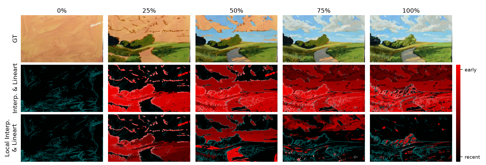
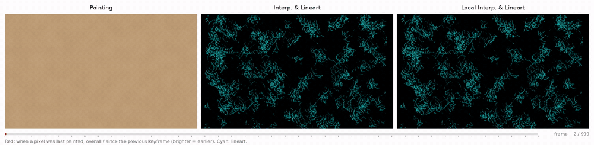
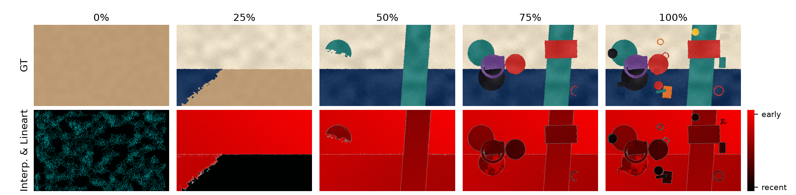
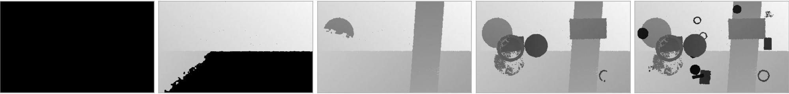
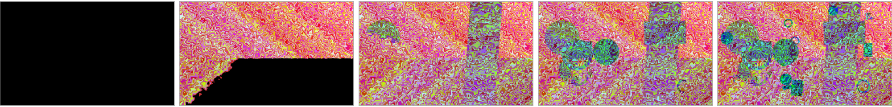
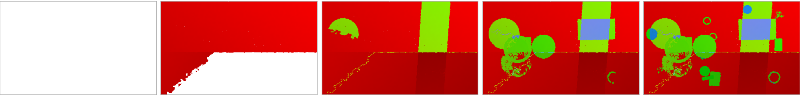
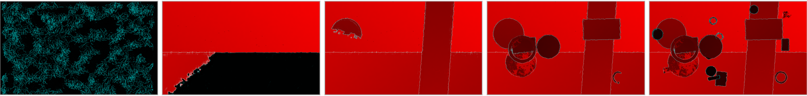
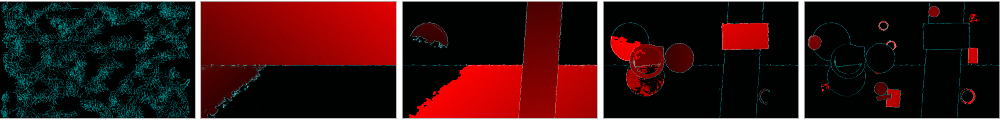

# Painting Change Map
<p align="center">
  Markus Pobitzer &nbsp;&nbsp; Chang Liu &nbsp;&nbsp; Niccolò Biondi &nbsp;&nbsp; Nicu Sebe<br>
  University of Trento, Italy<br>
  <b>WACV 2027</b>
</p>
<p align="center">
  <a href='https://arxiv.org/abs/2610.25369'>
    </a>
</p>

Painting Change Map as guidance for generating painting processes.



Source video from the Painting with Samir YouTube channel: https://www.youtube.com/watch?v=2nGWkASv--Y. Frames © Painting with Samir, used with permission; they are not covered by the [MIT License](LICENSE).

A painting change map records, for every pixel, when it was last painted. We combine it with lineart as the control signal:
red encodes the time of the last change (brighter = earlier, black = untouched canvas), cyan is the lineart.

- **Interp. & Lineart**: all changes up to the current frame, over the whole painting process.
- **Local Interp. & Lineart**: only the changes since the previous frame, so new strokes stand out.



## Usage

Requires Python >= 3.12 and [uv](https://docs.astral.sh/uv/).

```bash
uv sync
```

A CUDA GPU is optional: with `device="cpu"` the example below takes about a minute and 7 GB of RAM.
The lineart model ([lllyasviel/Annotators](https://huggingface.co/lllyasviel/Annotators)) is downloaded from Hugging Face on first use.

Compute the change maps of a painting video, here the synthetic [abstract painting](assets/abstract_painting.mp4):

```python
from painting_change_map.utils.painting_change import video_to_change_map_images
from painting_change_map.utils.video import load_video

video = load_video("assets/abstract_painting.mp4")  # 1000 frames, blank canvas -> finished painting
sampled_frame_indices = [0, 249, 499, 749, 999]
change_maps = video_to_change_map_images(video, sampled_frame_indices, mode="interpolate_lineart", device="cuda")
```



### Modes

Pass one of the following as `mode`, shown for the same frames as above.

#### Interpolation (`interpolate`)
Grayscale map whose brightness encodes when each pixel was last painted; black is untouched canvas.



#### Pack 24-bit (`pack_24bit`)
Stores the time of the last change losslessly across all 24 bits of the RGB channels instead of 256 gray levels.



#### History (`history`)
Encodes the last three changes of each pixel in the R, G and B channels; white is untouched canvas.



#### Interp. & Lineart (`interpolate_lineart`)
The interpolation map in the red channel, combined with the lineart of the frame in green and blue.



#### Local Interp. & Lineart (`local_interpolate_lineart`)
Like Interp. & Lineart, but the time scale only spans the changes since the previous frame, so new strokes stand out.



## Code availability

This repository contains the change map computation. Model weights and training code are not released; if you are interested, please open an issue.

## Citation


```bibtex
@misc{pobitzer2026pcm,
      title={Painting Change Map as guidance for generating painting processes},
      author={Markus Pobitzer and Chang Liu and Niccolò Biondi and Nicu Sebe},
      year={2026},
      eprint={2610.25369},
      archivePrefix={arXiv},
      primaryClass={cs.CV},
      url={https://arxiv.org/abs/2610.25369},
}
```
